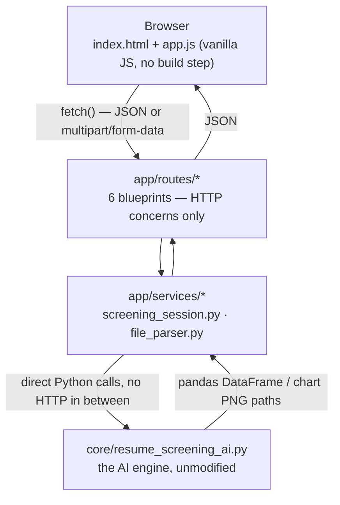
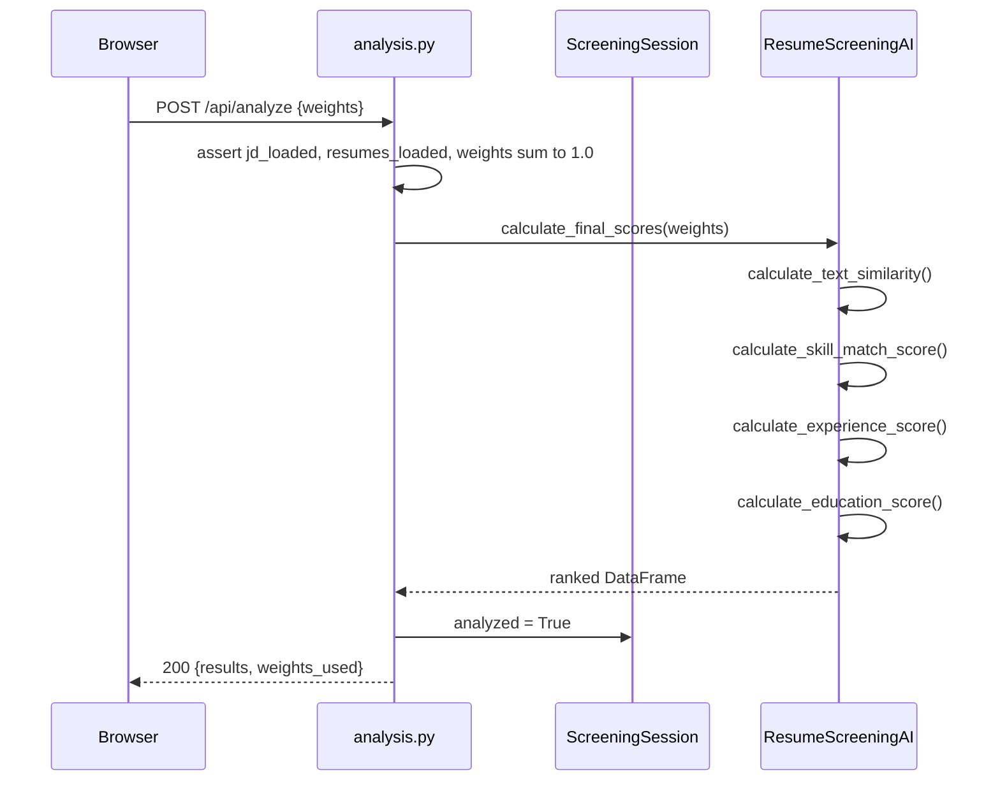

# Gauge — Resume Screening AI

A Flask web application built around a standalone resume-scoring engine
(`core/resume_screening_ai.py`). It ranks candidates against a job
description using TF-IDF text similarity, keyword-based skill matching,
and regex-extracted experience/education signals, combined into a single
weighted score. The web layer — routes, session handling, file parsing,
and the frontend — is a wrapper around that engine; none of the actual
scoring logic lives outside `core/`.

This document covers the architecture, the request/response contract for
every route, the scoring algorithm those routes are calling into, and the
things you'd need to know before changing or deploying any of it.

## Contents

- [Architecture](#architecture)
- [Project structure](#project-structure)
- [Getting started](#getting-started)
- [Configuration](#configuration)
- [The wizard workflow](#the-wizard-workflow)
- [API reference](#api-reference)
- [The scoring algorithm](#the-scoring-algorithm)
- [Frontend notes](#frontend-notes)
- [Testing](#testing)
- [The demo script](#the-demo-script)
- [Known limitations](#known-limitations)
- [Extending this](#extending-this)

---

## Architecture

Four layers, each only aware of the one directly below it:



**`core/`** is the only place with actual scoring logic, and it has no
knowledge that a web app exists — it's plain Python classes operating on
strings and DataFrames. It sits as a sibling of `app/`, not nested inside
it, specifically so importing it never pulls in Flask (`demo.py` at the
project root proves this: it imports directly from `core` and runs with
Flask uninstalled).

**`app/services/`** is where "AI engine" meets "web app." Two files:
`file_parser.py` turns an uploaded `.txt`/`.pdf`/`.docx` into the plain
string `core` expects, and `screening_session.py` wraps one instance of
the engine plus the three booleans (`jd_loaded`, `resumes_loaded`,
`analyzed`) that track wizard progress.

**`app/routes/`** is HTTP plumbing and nothing else — parse the request,
call a session method, return JSON. No route file imports `core`
directly except `analysis.py` (for `print_results_table`); everything
else goes through `current_app.screening_session`.

**`app/__init__.py`** is the application factory. `create_app(config_name)`
builds a `Flask` instance, attaches a fresh `ScreeningSession` to it, and
registers the six blueprints. Nothing at module import time starts a
server or holds state — that's deliberate, see [Testing](#testing).

## Project structure

```
resume-screening-app/
├── run.py                      # entry point — python run.py
├── demo.py                     # standalone CLI walkthrough, no Flask dependency
├── config.py                   # Config / DevelopmentConfig / TestingConfig / ProductionConfig
├── pytest.ini
├── requirements.txt             # runtime deps
├── requirements-dev.txt         # + pytest
├── .env.example                 # copy to .env for local overrides (gitignored)
├── .gitignore
│
├── core/
│   ├── __init__.py
│   └── resume_screening_ai.py   # TextPreprocessor, SkillExtractor, ExperienceAnalyzer,
│                                 # ResumeScreeningAI, ResumeScreeningVisualizer, print_results_table
│
├── app/
│   ├── __init__.py               # create_app()
│   ├── errors.py                 # ApiError + error handlers
│   │
│   ├── services/
│   │   ├── file_parser.py        # .txt/.pdf/.docx -> str
│   │   └── screening_session.py  # ScreeningSession class
│   │
│   ├── routes/
│   │   ├── pages.py              # GET /
│   │   ├── job_description.py    # POST /api/job-description
│   │   ├── resumes.py            # /api/resumes  (GET, POST, DELETE)
│   │   ├── analysis.py           # /api/analyze, /api/top-candidates, /api/candidate
│   │   ├── charts.py             # /api/chart/*
│   │   └── session.py            # POST /api/reset
│   │
│   ├── templates/
│   │   └── index.html            # single-page wizard, 4 steps
│   └── static/
│       ├── css/style.css         # light/dark theme via CSS custom properties
│       ├── js/app.js             # wizard state machine, no framework
│       └── charts/               # generated PNGs land here at runtime (gitignored)
│
├── scripts/
│   └── setup_nltk_data.py        # one-time NLTK corpus download
│
└── tests/
    ├── conftest.py                # app/client/jd_client/ready_client/analyzed_client fixtures
    ├── test_job_description.py
    ├── test_resumes.py
    ├── test_analysis.py
    ├── test_charts.py
    └── test_session_and_pages.py
```

## Getting started

Requires Python 3.10+ — `app/__init__.py` uses `str | None` union syntax
in a live-evaluated function signature (no `from __future__ import
annotations` there, unlike the service files, which do have it and would
tolerate an older interpreter despite similar-looking type hints).

```bash
pip install -r requirements.txt --break-system-packages   # drop the flag outside a managed/externally-managed environment
python scripts/setup_nltk_data.py                          # one-time: punkt, stopwords, wordnet, POS tagger data
python run.py
```

Serves on `http://127.0.0.1:5000`. `PORT` and `FLASK_ENV` are read from
the environment (see [Configuration](#configuration)) if you need
something other than the default.

`scripts/setup_nltk_data.py` exists because `core/resume_screening_ai.py`
also tries to download the same NLTK data on import, but wraps it in a
bare `except: pass` — a flaky connection on first run silently leaves the
app half-configured and it only surfaces later, mid-request, when
`word_tokenize()` throws a `LookupError`. Running the setup script first
makes that failure mode visible immediately instead.

## Configuration

`config.py` defines three environments as subclasses of `Config`:

| | `DEBUG` | `CHARTS_DIRNAME` |
|---|---|---|
| `DevelopmentConfig` | `True` | `charts` |
| `TestingConfig` | `False` | `charts_test` |
| `ProductionConfig` | `False` | `charts` |

`create_app()` picks one via the `FLASK_ENV` environment variable
(default `development`); `tests/conftest.py` always passes `'testing'`
explicitly. The separate `charts_test/` directory exists so running the
test suite while the dev server happens to be running doesn't have both
processes writing chart PNGs to the same folder.

`run.py` calls `load_dotenv()` before reading any environment variable,
so a local `.env` (copy `.env.example`, gitignored) overrides the
defaults without needing to export shell variables. There's nothing
secret in this app today — no database, no third-party API keys —
`SECRET_KEY` is read from the environment anyway because that's the
pattern you want in place *before* a real secret shows up, not retrofitted
after one gets hardcoded and committed.

## The wizard workflow

The frontend is a single page (`index.html`) with four sections toggled
by `app.js`; nothing reloads. Each step maps directly onto engine methods
called through the API:

| Step | UI does | Calls |
|---|---|---|
| 1. Define the role | Paste or upload a job description | `POST /api/job-description` → `ResumeScreeningAI.load_job_description()` |
| 2. Add candidates | Upload files and/or paste resume text, incrementally | `POST /api/resumes` (repeatable) → `ResumeScreeningAI.load_resumes()` |
| 3. Calibrate weights | Four sliders, must sum to 100% | `POST /api/analyze` → `ResumeScreeningAI.calculate_final_scores(weights)` |
| 4. Results | Sortable table, 4 chart views, candidate drill-down | `GET /api/top-candidates`, `GET /api/candidate`, `GET /api/chart/*` |

Editing the job description or the candidate pool after step 4 sets
`session.analyzed = False` server-side (see each route below), which the
frontend reflects by re-locking the "Results" tab in the stepper until
`/api/analyze` runs again. There's no way to view stale results next to
a changed input — the flag makes that state unreachable rather than
relying on the frontend to remember to hide it.

Sequence for the step that actually does the work:



## API reference

All request bodies are JSON unless noted as `multipart/form-data`. All
responses are JSON. Errors share one shape:

```json
{ "error": "human-readable message" }
```

raised via `app/errors.py`'s `ApiError` and caught by a blanket
`@app.errorhandler` — every route below only needs to specify *which*
status/message it raises, not how errors get serialized. Anything that
isn't an `ApiError` (a real bug) gets logged server-side with a full
traceback and returns a generic `500`, so a stack trace never leaks to
the client.

State is per-process, not per-request — see [Known limitations](#known-limitations)
before assuming otherwise.

### `GET /`

Renders `index.html`. No parameters, no auth.

---

### `POST /api/job-description`

Loads and preprocesses a job description. Two ways to send it:

**JSON:**
```json
{ "text": "We are hiring a Full Stack Python Developer..." }
```

**multipart/form-data:** a `file` field (`.txt`, `.pdf`, or `.docx`).
File upload takes priority if both are somehow present.

Rejects anything under 30 characters (`400`) — a guard against someone
pasting a fragment and getting a meaningless skill extraction back.

**200 response** (captured live against the example above):
```json
{
  "message": "Job description loaded",
  "preview": "We are hiring a Full Stack Python Developer...",
  "word_count": 28,
  "detected_skills": {
    "technical": ["aws", "docker", "flask", "git", "python", "react", "sql"],
    "soft": ["communication", "teamwork"],
    "total_count": 9
  }
}
```

`preview` is the first 500 characters of the input, `...`-suffixed if
truncated — for the frontend's confirmation card, not a stored value.

Sets `jd_loaded = True` and `analyzed = False` on the session — loading a
new JD always invalidates any prior analysis, even if the candidate pool
didn't change.

| Status | Cause |
|---|---|
| 200 | Loaded |
| 400 | Text under 30 chars, or unsupported file extension |

---

### `POST /api/resumes`

Adds one or more candidates to the pool. Always `multipart/form-data`,
with either or both fields present:

- `files` — zero or more file parts (`.txt`/`.pdf`/`.docx`)
- `pasted` — a JSON-encoded string: `[{"name": "...", "text": "..."}]`

New entries are **merged** with whatever's already in the pool (read back
via `ScreeningSession.loaded_resumes_as_list()`), so this can be called
repeatedly as someone adds candidates in batches — nothing needs to be
resent. A file's default candidate name comes from
`name_from_filename()`: `priya_sharma_resume.pdf` → `Priya Sharma Resume`.
A name collision doesn't overwrite the earlier entry; it gets suffixed
(`Sam Lee` → `Sam Lee (2)`) via `ScreeningSession.dedupe_name()`.

**200 response:**
```json
{
  "message": "2 resume(s) added (2 total)",
  "warnings": [],
  "resumes": [
    {
      "name": "Priya Sharma",
      "word_count": 18,
      "technical_skills": ["flask", "aws", "docker", "python", "react", "sql", "git"],
      "soft_skills": ["teamwork", "communication"],
      "years_of_experience": 4,
      "education": "Bachelors"
    }
  ]
}
```

A partially bad batch doesn't fail the whole request — an unsupported
file type or an empty-text PDF gets its message appended to `warnings`
while the rest of the batch still loads. The request only 400s if
*every* item in it was invalid.

Loading resumes sets `analyzed = False`, same reasoning as the JD route.

| Status | Cause |
|---|---|
| 200 | At least one resume loaded (others may have warned) |
| 400 | Nothing valid in the request at all |

**`GET /api/resumes`** — returns `{ "resumes": [...] }` in the same shape
as above, current pool, no side effects.

**`DELETE /api/resumes?name=<name>`** — removes one candidate by exact
name match. Deleting a name that isn't in the pool is a silent no-op
(still `200`, pool unchanged) rather than a `404` — the frontend fires
this from a list it already rendered, so a mismatch here would be a bug
in the client, not a meaningful user-facing error. Also sets
`analyzed = False`.

| Status | Cause |
|---|---|
| 200 | Removed (or no-op) |
| 400 | Missing `name` query parameter |
| 409 | Pool is already empty |

---

### `POST /api/analyze`

The core route — runs `ResumeScreeningAI.calculate_final_scores()`.

```json
{ "weights": { "text_similarity": 0.4, "skill_match": 0.3, "experience": 0.2, "education": 0.1 } }
```

`weights` is optional; omitting it (or sending `{}`) uses the engine's
own defaults (`0.4 / 0.3 / 0.2 / 0.1`). If provided, it must contain
*exactly* the four keys above (no subset, no extras) and sum to `1.0`
within `0.01` tolerance — both checked server-side even though the
frontend's sliders already enforce this, since the frontend isn't the
only possible caller of this endpoint.

**200 response**, two-candidate example:
```json
{
  "results": [
    {
      "Candidate": "Priya Sharma",
      "Rank": 1,
      "Final_Score": 55.46,
      "Text_Similarity": 38.65,
      "Skill_Match": 100.0,
      "Experience_Score": 20.0,
      "Education_Score": 60.0,
      "Technical_Skills": 7,
      "Soft_Skills": 2,
      "Years_Experience": 4,
      "Education_Level": "Bachelors"
    },
    {
      "Candidate": "Rahul Verma",
      "Rank": 2,
      "Final_Score": 7.02,
      "Text_Similarity": 5.04,
      "Skill_Match": 0.0,
      "Experience_Score": 5.0,
      "Education_Score": 40.0,
      "Technical_Skills": 2,
      "Soft_Skills": 0,
      "Years_Experience": 1,
      "Education_Level": "Diploma"
    }
  ],
  "weights_used": { "text_similarity": 0.4, "skill_match": 0.3, "experience": 0.2, "education": 0.1 }
}
```

All four `*_Score` fields and `Final_Score` are on a 0–100 scale (the
engine computes 0–1 internally and multiplies by 100 for display —
`weights_used` is the exception, still 0–1, since that's the literal
input to `calculate_final_scores`).

Also calls `print_results_table(results)` — check the terminal running
`run.py`; the same ASCII table the original script prints shows up there
on every analysis, unchanged.

| Status | Cause |
|---|---|
| 200 | Scored |
| 400 | `weights` present but wrong keys, or doesn't sum to 100% |
| 409 | No job description loaded yet, or the candidate pool is empty |

**`GET /api/top-candidates?n=5`** — `ResumeScreeningAI.get_top_candidates(n)`,
same row shape as above, top `n` only (default 5). `409` if
`/api/analyze` hasn't run yet.

**`GET /api/candidate?name=<name>`** — `ResumeScreeningAI.generate_candidate_report(name)`:

```json
{
  "name": "Priya Sharma",
  "rank": 1,
  "final_score": 55.46,
  "scores": { "text_similarity": 38.65, "skill_match": 100.0, "experience": 20.0, "education": 60.0 },
  "details": {
    "technical_skills": ["flask", "aws", "docker", "python", "react", "sql", "git"],
    "soft_skills": ["teamwork", "communication"],
    "years_of_experience": 4.0,
    "education_level": "Bachelors"
  }
}
```

| Status | Cause |
|---|---|
| 200 | Found |
| 400 | Missing `name` query parameter |
| 404 | No candidate with that exact name |
| 409 | Not analyzed yet |

---

### `GET /api/chart/*`

Five routes, each a direct call into `ResumeScreeningVisualizer`. None of
these return image bytes — they render a PNG to disk under
`app/static/<charts-dir>/` and return its URL:

```json
{ "image_url": "/static/charts/rankings_a1b2c3d4e5.png" }
```

The filename includes a random 10-hex-char suffix
(`ScreeningSession.fresh_chart_path()`) specifically so the browser never
serves a cached image from a reused URL after re-analysis — every call
generates a genuinely new file.

| Route | Engine method | Query params |
|---|---|---|
| `/api/chart/rankings` | `plot_candidate_rankings` | `top_n` (default 10) |
| `/api/chart/breakdown` | `plot_score_breakdown` | `name` (required) |
| `/api/chart/skills` | `plot_skills_comparison` | `top_n` (default 5) |
| `/api/chart/distribution` | `plot_score_distribution` | — |
| `/api/chart/summary` | `generate_summary_report` | — |

All five `409` if `/api/analyze` hasn't run. `breakdown` additionally
`400`s on a missing `name` and `404`s on an unknown one. Every route
calls `plt.close('all')` after saving — `resume_screening_ai.py` itself
never closes its figures (it was written assuming `plt.show()` would be
the end of the story), so that cleanup lives here rather than touching
the original file.

---

### `POST /api/reset`

Calls `ScreeningSession.reset()` — new `ResumeScreeningAI` instance, all
three progress flags back to `False`. No request body, no meaningful
failure mode; always `200`.

## The scoring algorithm

Documented here because understanding it explains *why* the API behaves
the way the examples above show — e.g. why Rahul Verma's `Skill_Match`
is exactly `0.0`, not just low.

1. **Preprocessing** (`TextPreprocessor`): lowercase → strip URLs/emails
   → strip anything that isn't a letter or whitespace → tokenize
   (`nltk.word_tokenize`) → drop stopwords and tokens ≤2 characters →
   lemmatize (`WordNetLemmatizer`).

2. **Text similarity**: the preprocessed JD and every preprocessed resume
   go into one `TfidfVectorizer(max_features=500, ngram_range=(1,2))`,
   fit across all of them together. `Text_Similarity` is the cosine
   similarity between the JD's row and each resume's row.

3. **Skill match**: `SkillExtractor` checks the *raw* (not preprocessed)
   resume text for **substring** matches against two fixed sets — 34
   technical keywords, 12 soft-skill keywords. `Skill_Match` is the
   Jaccard similarity (`|intersection| / |union|`) between the JD's
   matched-skill set and the candidate's. An empty candidate skill set
   scores `0.0` by definition, not a division error.

   Substring matching means `"javascript"` in a resume also matches the
   keyword `"java"` — that's the original engine's behavior, not
   something the web layer adds or corrects.

4. **Experience**: `ExperienceAnalyzer` runs three regex patterns
   (`\d+\+?\s*years?\s*(?:of)?\s*experience`, an `experience: N years`
   form, and a bare `\d+\+?\s*years?` fallback) against the raw text and
   takes the **maximum** number found anywhere in the document.
   `Experience_Score` is `min(years / 20, 1.0) * 100` — twenty years is
   the normalization ceiling, so 22 years of experience scores exactly
   the same as 20. Only numerals are recognized; "five years" doesn't
   match any of the three patterns.

5. **Education**: the raw text is checked against four keyword tiers, in
   priority order — PhD/doctorate, then Masters/MBA/MTech, then
   Bachelors/BTech/BE, then Diploma/Associate — first match wins, mapped
   to a fixed weight (`{PhD: 1.0, Masters: 0.8, Bachelors: 0.6,
   Diploma: 0.4, Other: 0.2}`) and shown as `Education_Score * 100`.

6. **Final score**: `weights.text_similarity * text_sim + weights.skill_match
   * skill_match + weights.experience * exp_score + weights.education *
   edu_score`, all four inputs on a 0–1 scale before the final `* 100` for
   display.

## Frontend notes

`app/static/js/app.js` is plain JavaScript against `fetch()` — no
framework, no build step, no `npm install`. `app/templates/index.html`
loads Tailwind and Lucide icons from CDNs at request time.

Theming is a single `data-theme` attribute on `<html>`, toggled by a
small inline script in `index.html` (not `app.js` — it's a presentation
concern, not wizard state) and persisted to `localStorage`. Every color
in `style.css` is a CSS custom property redefined once per theme;
Tailwind's config maps its color keys (`ink-800`, `text-brass`, etc.) at
those same variables, so the utility classes used throughout the markup
stay theme-correct without `dark:` variant classes anywhere.

One deliberate exception: `.chart-frame`'s background is a fixed light
tone in *both* themes, not a themed variable. The PNGs it frames are
matplotlib figures with a plain white background regardless of app
theme — tying the frame to the theme variable would put a dark frame
around a white chart in dark mode.

## Testing

```bash
pip install -r requirements-dev.txt --break-system-packages
pytest
```

39 tests, in-process against Flask's test client — no server, no `curl`,
around 7–8 seconds total. `tests/conftest.py` builds fixtures that layer
on each other (`app` → `client` → `jd_client` → `ready_client` →
`analyzed_client`) so each test file only asks for as much setup as it
needs.

Each test gets its own `create_app('testing')` instance, which means its
own `ScreeningSession` — the single-global-state design described above
would otherwise make tests leak into each other, since two tests calling
`/api/analyze` in the same process would be scoring against whatever the
*other* test left loaded. This is the actual reason `ScreeningSession`
is a class attached per-app-instance instead of a module-level dict.

## The demo script

```bash
python demo.py
```

A non-web walkthrough of the same engine: loads a sample JD and three
resumes, prints the ranked table, saves `rankings.png` and `summary.png`,
exports `results.csv` — all to the current directory. Useful for
verifying the scoring logic in isolation, or as a five-line reference for
the `ResumeScreeningAI` API if you're integrating it somewhere that isn't
this Flask app. Needs the same `requirements.txt`, minus the fact that it
never touches Flask at runtime (see the `core/` note in
[Architecture](#architecture)).

## Known limitations

Things found while building and stress-testing this, not a generic
disclaimer list:

- **Single global session, no auth, no multi-tenancy.** One
  `ScreeningSession` per running process. Two people hitting the same
  server see and overwrite each other's data. Fine for the intended use
  (one person, running this locally); a hard blocker for anything else.
- **Nothing persists.** Restart the process, lose the loaded JD,
  candidate pool, and last analysis. There's no database in this project.
- **PDF parsing is text-only.** `pypdf` extracts embedded text; a
  scanned resume with no text layer returns empty and gets rejected as
  unsupported, same as a genuinely corrupt file.
- **Skill and experience extraction are keyword/regex-based, not NLP.**
  Substring matching (see `javascript`/`java` above) and numerals-only
  experience parsing are characteristics of the underlying engine, not
  bugs in the web layer around it.
- **`run.py` runs Flask's development server.** Fine for local use;
  `debug=True` and the built-in server are both explicitly unsuited to
  handling real traffic. There's no WSGI server (gunicorn/uwsgi) wired
  up in this project.

## Extending this

- **Multi-user support**: replace the single `app.screening_session`
  attribute with a dict keyed by something per-visitor (a signed cookie,
  `flask.session['id']`, a real auth token) and look the right session up
  at the top of each route. Nothing else in `app/routes/` or
  `app/services/` would need to change — they already only interact with
  `session` as a local variable, never the app-level attribute directly.
- **Persistence**: swap `ScreeningSession.ai` for something backed by a
  database instead of an in-memory `ResumeScreeningAI`, and add
  `DATABASE_URL` to `config.py` next to `SECRET_KEY` — same
  environment-variable pattern already in place.
- **A real production server**: add `gunicorn` to `requirements.txt` and
  run `gunicorn 'app:create_app()'` instead of `python run.py`; `run.py`
  itself only exists for local development.
- **CI**: `requirements-dev.txt` plus `pytest` has zero external service
  dependencies (no DB, no network calls beyond the one-time NLTK
  download), so a GitHub Actions job that runs
  `pip install -r requirements-dev.txt && python scripts/setup_nltk_data.py && pytest`
  would need no changes to this repo to work.